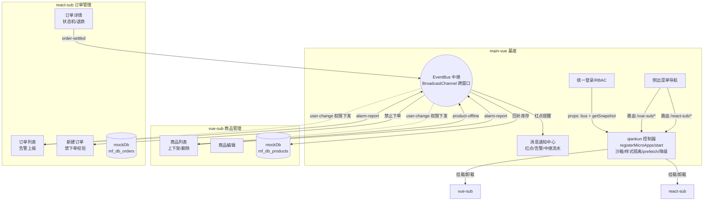
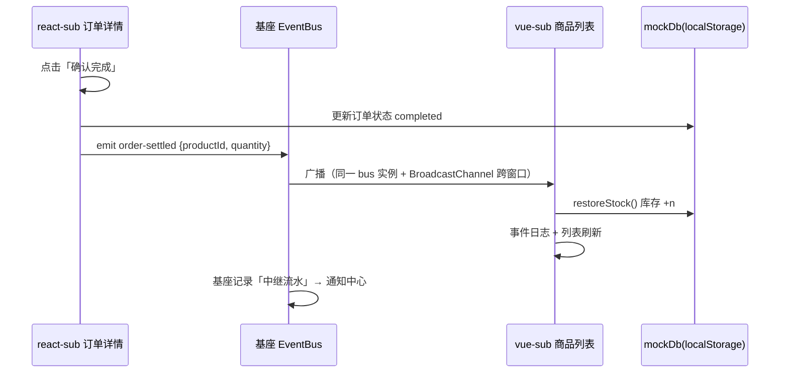

# 微前端统一运营管控平台（qiankun 演示项目）

> 面试演示项目：qiankun 微前端架构 + 跨技术栈业务联动通信。
> 重功能与可演示性，UI 刻意保持朴素。

## 项目组成

| 应用 | 技术栈 | UI 框架 | 角色 | 端口 | 独立访问 |
|---|---|---|---|---|---|
| main-vue | Vue 3 + TS + vue-router | ant-design-vue 4 | 基座：统一登录 / RBAC / 侧边菜单 / 消息通知中心 / EventBus 中继 | 5173 | — |
| vue-sub | Vue 3 + TS + vue-router | ant-design-vue 4 | 商品管理：增删改查 / 库存 / 上下架 | 5174 | http://localhost:5174/vue-sub/ |
| react-sub | React 19 + TSX + react-router-dom | antd 5 | 订单管理：列表 / 状态流转 / 新建 / 退款 | 5175 | http://localhost:5175/react-sub/ |

## 快速启动

```bash
# 三个终端分别启动（首次需 npm install）
cd main-vue  && npm install && npm run dev    # 基座
cd vue-sub   && npm install && npm run dev    # 商品子应用
cd react-sub && npm install && npm run dev    # 订单子应用
```

访问 http://localhost:5173 ，任意用户名 + 任意非空密码登录，角色选 admin/operator/viewer。
登录后进入「演示说明」页，包含全部联动场景的操作步骤。

## 业务架构



## 跨应用通信协议（三端 `shared/contract.ts` 完全一致）

| 事件名 | 方向 | payload | 场景 |
|---|---|---|---|
| `micro:user-change` | 基座 → 两子应用 | `{ user, permissions }` | 1. 用户/权限变更下发 |
| `micro:product-offline` | vue-sub → react-sub | `{ productId, productName, operator, time }` | 2. 下架禁止下单 |
| `micro:product-online` | vue-sub → react-sub | 同上 | 2. 恢复下单 |
| `micro:order-settled` | react-sub → vue-sub | `{ orderId, productId, quantity, type: 'complete'\|'refund', time }` | 3. 回补库存 |
| `micro:alarm-report` | 子应用 → 基座 | `{ level, source, title, message, time }` | 4. 告警红点 |

**联动时序（以场景 3 为例）：**



## RBAC 权限矩阵

| 权限码 | admin | operator | viewer |
|---|---|---|---|
| product:view / create / edit / shelf | ✅ | ✅ | 仅 view |
| product:delete | ✅ | ❌ | ❌ |
| order:view / create / edit / refund | ✅ | ✅ | 仅 view |

权限只在基座维护（`ROLE_PERMS`），通过 props 快照 + `user-change` 事件同步给子应用；子应用按钮用 `hasPerm()` 条件渲染。

## qiankun 能力实现位置

| 能力 | 实现 | 位置 |
|---|---|---|
| 路由同步 | 基座 history 模式 + `/vue-sub/:pathMatch(.*)*` catch-all；子应用路由 base 与 activeRule 一致 | `main-vue/src/router`、两子应用 router |
| JS 沙箱 | `start({ sandbox })`（Proxy 沙箱默认开启） | `main-vue/src/micro` |
| 样式隔离 | 关闭 `experimentalStyleIsolation`，依赖 antd CSS-in-JS 组件级隔离 + 三端统一 `reset.css`；保留 JS Proxy 沙箱 | `main-vue/src/micro` |
| prefetch | `start({ prefetch: ['vue-sub','react-sub'] })` | `main-vue/src/micro` |
| 加载错误降级 | `addGlobalUncaughtErrorHandler` + 容器内降级 UI + 告警 | `main-vue/src/micro` |
| unmount 清理防泄漏 | 订阅返回解绑函数，收集进 disposers，unmount 统一执行 | 两子应用 main 生命周期 |
| 子应用独立运行 | `qiankunWindow.__POWERED_BY_QIANKUN__` 判断 + 本地 bus 降级 | 两子应用 main |

## 数据层说明

演示项目无后端，用 **localStorage 充当共享 mock 后端**（`mf_db_products` / `mf_db_orders`）：

- qiankun 内子应用 JS 运行在基座页面上下文，localStorage 按基座同源（:5173）共享，两应用天然读写同一份数据；
- **事件负责「实时通知」，库负责「最终一致」**：即使订阅方当时未挂载，重新挂载后读库也能拿到最新状态；
- `storage` 事件 + `BroadcastChannel` 支持双窗口并排演示联动（详见基座「演示说明」页）。

恢复演示数据：控制台执行 `localStorage.clear()` 后刷新。

## 目录结构

```
micro-frontend/
├── README.md / interview.md        # 本文档 / 面试问答
├── main-vue/                         # 基座（Vue3）
│   └── src/
│       ├── shared/contract.ts        # 通信契约（事件/类型/权限）
│       ├── shared/EventBus.ts        # 基座总线（BroadcastChannel 中继）
│       ├── store/user.ts             # 登录 + RBAC
│       ├── store/notification.ts     # 消息通知中心
│       ├── router/index.ts           # history 路由 + 登录守卫 + catch-all
│       ├── micro/index.ts            # qiankun 注册/沙箱/prefetch/降级
│       ├── layout/MainLayout.vue     # 菜单 + 顶栏 + #micro-container
│       └── views/                    # LoginPage / DemoPage(演示说明)
├── vue-sub/                          # 商品管理子应用（Vue3）
│   └── src/{shared,store,router,views}
└── react-sub/                        # 订单管理子应用（React19 + TSX）
    └── src/{shared,pages}
```

## 已知取舍

- mock 数据放 localStorage、告警不做持久化 —— 演示项目优先联动可观察性；
- 子应用各自内置 contract 副本 —— 真实项目应抽 `@scope/micro-contract` npm 包共享；
- 样式隔离选择 antd 自带 CSS-in-JS 而非 qiankun `experimentalStyleIsolation`：后者与 cssinjs 运行时注入、弹层 body portal 不兼容；代价是三端共享 `.ant-*` 类前缀与全局 reset，生产可借 ConfigProvider `prefixCls` 改名或切换 Shadow DOM；
- 全量引入 antd / ant-design-vue（非按需）—— 演示项目代码简洁优先；生产环境应配置按需加载或 tree-shaking（antd v5 默认支持，ant-design-vue 需 `unplugin-vue-components`）。
